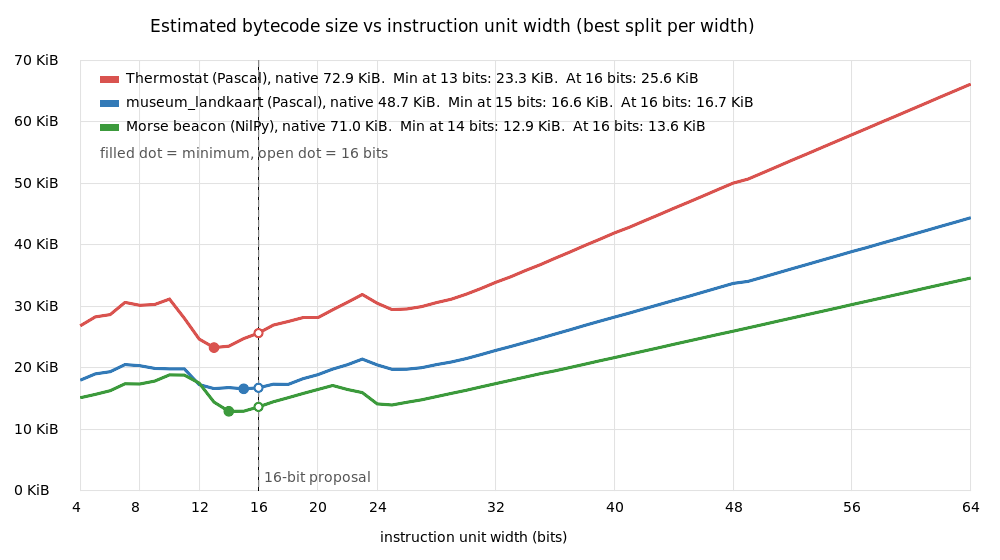

# Bytecode VM: proposed instruction format, with census evidence

_Design discussion between the owner and an agent, 2026-10-15. This is a
proposal, not a plan: nothing is built, and the owner decides if and when it
starts. Background and the decision for our own fat bytecode over wasm/WAMR:
[bytecode-vm-for-mcus.md](bytecode-vm-for-mcus.md)._

## 1. The proposal in one page

| Property | Choice |
|---|---|
| Machine model | **Register VM.** A register is a frame slot in RAM. |
| Instruction unit | **16 bits**, stored as-is in flash and executed in place. |
| Unit layout | `E:1 \| op:5 \| rA:5 \| rB:5` |
| Opcodes | E+op = **64 opcodes**. E=0 is the hot half, E=1 the rarer half, and one or two values mean "longer instruction, next unit follows". |
| Registers | **32 per function** (r0–r31). Untyped 32-bit slots. Int64 and double take an adjacent pair. |
| Operand shapes | `rA, rB`, or `rA, p5` (5-bit immediate or index), or rA+rB read together as a 10-bit offset or index (jump, call). The opcode decides the shape. |
| Arithmetic | Two-address: `rA := rA op rB`. |
| Types | **In the opcode** (`add.i32`, `add.i64`, `add.f32`…), never as tags on values. |
| Branches | **Fused compare-and-branch**, with no flags register and no predication. |
| Calls | **Overlapping frames.** The caller computes arguments into its top consecutive registers, and those become the callee's r0…rN. Results come back in the same slots. |
| Heavy work | **Fat opcodes** (string assign, concat and compare, variant and container ops) that call the native RTL. Cold operations go through a native-call table, the versioned host API. |
| Pointers | 32-bit VM addresses (indices), never host addresses. That makes the same bytecode run on ESP and PC. |
| Strings and objects | 32-bit handles into a handle table, so the compacting heap moves data without scanning registers. Each function header has a bitmask of its string slots, used for scope-exit release and exception unwinding. |

## 2. Evidence: the census

**Method.** Three apps were compiled for the ESP32-C3 at -O2 with the frozen
compiler `rv32-ak-6bfcd631e0`. A copy of the compiler that also prints each
symbol's kind in `--dump-ir` (see section 6) dumped the optimized IR. A script
then estimated the register-VM instructions each IR node would become (cost
model in section 5). The RTL is excluded on both sides, because it stays native
in the firmware. Native sizes are the app procedures' .text in the same compile.

| | Remote thermostat | museum_landkaart | Morse beacon |
|---|---|---|---|
| Language | Pascal | Pascal | NilPy |
| Kind | IO + web API | IO + web API | IO over I2C, dict, parser |
| App procedures | 165 | 97 | 18 |
| Native .text (app procedures) | 74,660 B | 49,828 B | 72,656 B |
| Estimated VM instructions | 6,902 | 4,713 | 4,039 |
| Bytecode at 4 B/instruction | 27.6 KB | 18.9 KB | 16.2 KB |

The morse beacon is `examples/esp32/nilpy-morse/morse_beacon.npy`, written for
this census. museum_landkaart normally builds without -O2; -O2 was added here
so the three are measured alike.

### 2.1 Registers needed per procedure

"Peak" counts named locals and parameters, plus expression temporaries
(Sethi-Ullman style), plus consecutive argument slots for calls. It assumes
every local is alive for the whole procedure, so it is an **upper bound**.
Sharing slots by liveness would lower it.

| | Thermostat | landkaart | Morse |
|---|---|---|---|
| Peak registers: median / p90 / max | 6 / 11 / **16** | 5 / 11 / **19** | 6 / 19 / **24** |
| Share of instructions in procedures with peak > 8 | 58% | 51% | 83% |
| … with peak > 16 | 0% | 12% | **75%** |
| … with peak > 32 | 0 | 0 | 0 |
| Most arguments in one call | 6 | 6 | 6 |

### 2.2 Opcode coverage

Static share of instructions covered by the N most frequent VM ops. The
grouping of IR nodes into VM ops is the script's.

| Top N ops | Thermostat | landkaart | Morse |
|---|---|---|---|
| 15 | 81.6% | 81.5% | 93.2% |
| 31 | 94.0% | 94.3% | 98.6% |
| 48 | 97.9% | 98.5% | 99.8% |
| 64 | 99.3% | 99.8% | 100% (55 distinct) |

The two Pascal apps share 29 of their top 31 ops, and the thermostat's top 31
cover 96.6% of landkaart. That was measured over the 45 most frequent ops of
each app, which is all the script prints. NilPy adds its own hot set (see 2.5),
and the union is estimated at 45–50 hot ops, which fits 64.

### 2.3 Branch distances, in VM instructions

| | Thermostat | landkaart | Morse |
|---|---|---|---|
| Branches | 1,143 | 787 | 270 |
| Median / p90 | 4 / 27 | 5 / 27 | 3 / 1,690 |
| Beyond ±127 | 2% | 3% | 12% |
| Distance ≤ 2 (skips a 1-instruction body) | 31% | 27% | 45% |

The morse beacon's p90 is huge because its module body, mostly the 41-entry
dict literal, is a single procedure of about 2,400 instructions.

### 2.4 Immediates

| Constant needs | Thermostat | landkaart | Morse |
|---|---|---|---|
| 5 bits (−16..15) | 1,019 (65%) | 816 (68%) | 272 (48%) |
| 7 bits | 219 | 128 | 87 |
| 14 bits | 209 | 151 | 200 |
| 22 bits | 49 | 34 | 2 |
| 32/64 bits (constant pool) | 80 | 69 | 6 |

### 2.5 Most frequent operations

| Thermostat (Pascal) | Count | Morse (NilPy) | Count |
|---|---|---|---|
| load constant | 818 | address-of | 913 |
| address-of (`Result`, var params) | 707 | load constant | 461 |
| jump | 456 | load string literal | 425 |
| load string literal | 453 | store to memory | 274 |
| string assign (fat) | 450 | index | 256 |
| load from memory | 322 | variant store | 249 |
| load global | 261 | load global | 138 |
| string concat (fat) | 253 | branch-if-false | 114 |
| index | 233 | `PXXNilRef` | 93 |
| int64 add | 187 | jump | 84 |
| int32 add | 30 | string assign | 76 |
| string-equal branch (fat) | 73 | `PXXVarClear` | 57 |
| | | dict setitem | 45 |

**What stands out:**
- **Strings dominate Pascal.** Assign, concat, literals and compares together
  are the largest group.
- **The thermostat's arithmetic is mostly Int64** (millisecond timestamps):
  int64 add outnumbers int32 add six to one. So 64-bit ops need full opcodes,
  not a prefix.
- **NilPy is heavy.** About 170 source lines compile to 72.7 KB of native code.
  The 41-entry dict literal alone costs about 60 instructions per entry (31 KB
  native for the module body). A fat "build dict from a constant table" op
  would collapse it. That would help the native backends too, independent of
  the VM.

## 3. The decisions, with the alternatives considered

### 3.1 Register VM, not stack VM

**Chosen by the owner.** A register VM executes fewer instructions (Dalvik's
published comparison: about 47% fewer than a stack VM, at about 25% more code
bytes). It also maps directly onto pxx's IR, where operands name values.

### 3.2 Unit size: 16 bits

| Alternative | Why not |
|---|---|
| 8-bit units / byte stream | Too few operand bits per unit. Every register reference costs extra bytes. |
| 15-bit units carried as Unicode text (curated "safe" CJK rows) | Designed for copy-paste installs. **Dropped by the owner:** any binary can be encoded for transport, so the ESP form should not waste a bit per unit on it. |
| Fixed 32 bits (Lua 5.4: op 7, A 8, B 8, C 8) | Simplest decoder and plenty of registers, but the census shows 8-bit register fields are oversized (max peak 24). |
| **16 bits (chosen)** | Dalvik's unit. It holds a 6-bit opcode and two 5-bit registers. Long forms use a second unit. |

### 3.3 Register field width: 5 bits (32 registers)

| Width | Registers | Opcode bits left (16-bit unit, two register fields) | Verdict |
|---|---|---|---|
| 3 | 8 | 10 | No. 51–83% of instructions are in procedures needing more than 8. |
| 4 | 16 | 8 | No. It fits the thermostat exactly, but 12% (landkaart) and 75% (morse) of instructions are in procedures needing more than 16. |
| **5** | **32** | **6** | **Chosen.** Every procedure in all three apps fits, with headroom over the worst (24). 64 opcodes is where coverage flattens. |
| 6 | 64 | 4 | No. 16 opcodes cover only about 80–93%. |

Five bits is where both curves meet: 32 registers covers register need, and 64
opcodes covers opcode need.

### 3.4 Opcode field: E + 5 bits, read together as a 6-bit opcode

The owner's layout: an escape bit plus a 5-bit op field. The VM dispatches on
all six bits through a 64-entry table, so splitting them into "E" and "op" is
only a numbering convention. It is still a useful one: one bit tells hot from
rare.

| Alternative | Why not |
|---|---|
| A family/op/subcode split (3+3+3…) | Opcodes are dispatched through a table anyway, so fields give no decoding speed. They also waste codes on families that don't need all their slots. |
| A "longer instruction follows" flag bit | Spends half of all codes to mark length. A reserved opcode value costs 1/64. The VM knows each opcode's length from a table anyway. |
| 5-bit opcode only, with an escape value (31 ops in one unit) | Covers 94–98.6%. Six bits covers 99.3–100% at no cost, since the 16th bit is free. |

### 3.5 No predication / skip bit

ARM32 put a 4-bit condition on every instruction. AArch64 dropped it. On
hardware, predication avoids pipeline flushes from mispredicted branches. A VM
has no such pipeline, because every instruction already goes through an
indirect jump. The census does show many short skips (27–45% of branches jump
over 1–2 instructions), but with fused compare-and-branch the count is equal:

| Scheme | `if a < b then x := 1` |
|---|---|
| Fused compare-and-branch | `blt…` + `li x,1` = 2 instructions |
| Compare sets a flag + predicated instruction | `cmp a,b` + `li.if x,1` = 2 instructions |

Predication would cost a flag register to save across calls, a test on every
dispatch, and half the opcode space. **If ever needed:** a few "skip next if"
opcodes (as on PIC or in Lua) cost a few opcode slots, not a bit everywhere.

### 3.6 Branches: fused compare-and-branch

Two registers plus an offset do not fit one 16-bit unit, so the fused form is
two units: escape plus rA plus rB in the first, condition plus a 12-bit offset
in the second. It still runs as one dispatch. Branches beyond the offset (2–12%
by app) are relaxed the RISC-V way: invert the condition and jump over a long
unconditional jump.

| Alternative | Why not / status |
|---|---|
| Compare instruction, then a separate jump instruction (Lua) | The VM can run the pair in one dispatch, but it always takes two instructions in flash. |
| A flags register (x86/ARM) | State to save across calls, and no gain (see 3.5). |
| One-unit `br.zero rA, off5` / `br.nz rA, off5` (±16) | **Recommended addition.** Testing against zero (booleans, `if flag`) is the commonest branch, and median branch distances are 3–5. |

Only `eq`, `ne`, `lt`, `le`, `ltu` and `leu` are needed: `gt` and `ge` are the
same with the operands swapped. Across int32, int64, float and string eq/ne,
that is about 15–20 opcodes.

### 3.7 Types: in the opcode, registers untyped, 32-bit slots

| Alternative | Why not |
|---|---|
| Tagged values (Lua, CPython) | Needed for dynamic typing. pxx knows every type at compile time, so tags would only cost RAM in every slot and a check in every op. |
| Type as a 5-bit operand (`add rA, type`) | Hides a second dispatch inside the first for the commonest ops. It is fine for rare ops (conversions, loads and stores with a width). |
| 64-bit slots everywhere | Simpler, but doubles every frame. RAM comes first on ESP (owner, 2026-10-12). |

Values narrower than 32 bits are held as 32 bits and narrowed only on
load/store (`ld.s8`, `st.16`), and in explicit `sext`/`zext` ops where Pascal
truncates on assignment.

**Risk:** untyped registers trust the bytecode. Bytecode that uses an integer
as a handle crashes the VM. While the compiler is the only producer, a checksum
is enough. A Dalvik/JVM-style verifier at install time can be added later
without changing the format.

### 3.8 No register swapping or windows

VM registers are memory, so swapping a value into a "near" register gains only
encoding bits, and costs a dispatch each time. With 32 registers no procedure
in the census needs it.

| Alternative | Why not |
|---|---|
| `xchg rLow, rHigh` to reach beyond the encodable registers | Needed only with 3- or 4-bit fields. It brings back hard register allocation. |
| A movable register window (Z80 `EXX`, SPARC) | The compiler would need window planning per loop. Not needed at 32 registers. |

**Two moves worth having anyway:**
- `xchg rA, rB`, to resolve cycles when placing call arguments (`f(b, a)`).
- `mov64`, to copy an Int64 or double pair in one op.

### 3.9 Two-address arithmetic

With two register fields, arithmetic is `rA := rA op rB`. That costs an extra
`mov` when both operands stay alive (Dalvik and Thumb make the same trade). If
the backend shows many such moves, three-address forms of `add`/`sub` can be
added through the escape opcode.

## 4. Size estimate for the 16-bit format

| Instruction | Units |
|---|---|
| Opcode in the 64, operands fit (two registers, or a register plus a 5-bit value) | 1 |
| Immediate wider than 5 bits (32–52% of constants) | 2 |
| Fused compare-and-branch | 2 |
| String literal or constant-pool index beyond 5 bits | 2 |

**Not measured.** The opcode coverage in 2.2 is not the same as "fits one
unit", because operand width also decides. A rough count for the thermostat:
about 2,000 of the 6,902 instructions need a second unit. That gives about 18
KB, about 4× smaller than native. The census script should get a per-instruction
"fits one unit" check before this number is quoted anywhere.

### 4.1 Sweep: unit widths from 4 to 64 bits

`bytecode-census/sweep.py` takes each instruction's real operands (register
numbers from its procedure's peak, immediate widths, branch offsets, and
literal, global and call indices). For each unit width W from 4 to 64 bits, it
tries every register-field width r, with opcode bits o = W - 2r. An instruction
takes one unit when its opcode is among the 2^o - 1 most frequent, its
registers fit in r bits, and its payload fits in the leftover operand bits.
Otherwise it takes an escape unit plus a wide form (8-bit opcode, 8 bits per
register, the payload at full width) in ceil(bits / W) more units.

| Width | Thermostat | landkaart | Morse |
|---|---|---|---|
| Minimum | 13 bits: 23.3 KiB | 15 bits: 16.6 KiB | 14 bits: 12.9 KiB |
| **16 bits** | 25.6 KiB (+10%) | 16.7 KiB (+1%) | 13.6 KiB (+5%) |
| 8 bits | 30.2 KiB | 20.3 KiB | 17.3 KiB |
| 32 bits | 33.9 KiB | 22.8 KiB | 17.4 KiB |
| Native rv32 (app procedures) | 72.9 KiB | 48.7 KiB | 71.0 KiB |

The minimum lies between 13 and 15 bits for all three apps. 16 bits is the
nearest width that byte-addressed flash can fetch directly, and costs only 1–10%
over the minimum. Above about 24 bits nearly everything fits one unit, so size
grows linearly with the width. Below 12 bits, too much spills into long forms.
At 16 bits the best split is r = 5, o = 6 for all three apps, which is the
proposal's layout. The sweep counts more instructions than section 2
(argument moves are included), so its totals are not directly comparable with
the 4-byte column there.

## 5. Caveats

- **The cost model is rough.** Each IR node gets a fixed cost. Local loads and
  small constants feeding arithmetic or branches are free. A compare feeding a
  branch is fused. Stores of computed values into locals are free, and string
  stores are one fat op. The model is not a backend.
- **Static counts, not execution frequency.** A dynamic profile could rank
  opcodes differently.
- **Three apps, two of them IO/web in Pascal.** A compute-heavy app, or a
  larger NilPy app, should be checked before the 64-opcode table is frozen.
- **App procedures were matched by name** against the source (thermostat 165,
  landkaart 97), and the morse beacon's 18 were listed explicitly.
  Inlined procedures and IDF imports are not counted.
- **Native sizes come from symbol spacing in the object,** so they can include
  literal data placed inline in the code.
- **Peak registers is an upper bound** (no liveness sharing).

## 6. Reproducing the census

The tooling is in [`bytecode-census/`](bytecode-census/):

1. **Build the dump compiler.** Apply `dump-ir-scope.patch` to a scratch copy
   of `compiler/` and build it with the pinned compiler. The patch adds the
   symbol kind and the source file and line to `--dump-ir` output. Place the
   binary inside the scratch `compiler/` directory, so it finds `builtin/`.
2. **Dump an app** with the app's own flags plus `--dump-ir -O2`, writing
   stdout to a file. For example, the thermostat:
   `pxxdump --dump-ir --target=riscv32 --platform=esp --no-signals -O2 --max-stack-frame=16384 --emit-obj -Fusrc -Fisrc -Fu$RTL -Fu$RTL/platform/esp src/thermo_esp.pas out.o > ir.txt`
3. **Run** `census.py ir.txt SRC_DIR out.o [NAME,NAME,...]`, and `sweep.py` with the
   same arguments for the unit-width sweep (section 4.1).

## 7. Open questions

1. **The size estimate for 16-bit units:** add the per-instruction one-unit
   check to the script (section 4).
2. **Which ops get the 32 hot slots and which the 32 rare slots:** the union
   of the Pascal and NilPy hot sets, taken from a dynamic profile rather than
   static counts.
3. **NilPy fat ops:** variant store and clear, nil-ref, tag tests, dict and
   list literals from flash tables. These are worth doing for the native
   backends too.
4. **String literal and constant indices:** a 5-bit index reaches only 32
   literals per function. Is the second unit common enough to justify a
   one-unit "load literal with a 10-bit index into a fixed register" form?
5. **A compute-heavy sample app** before freezing the table.
